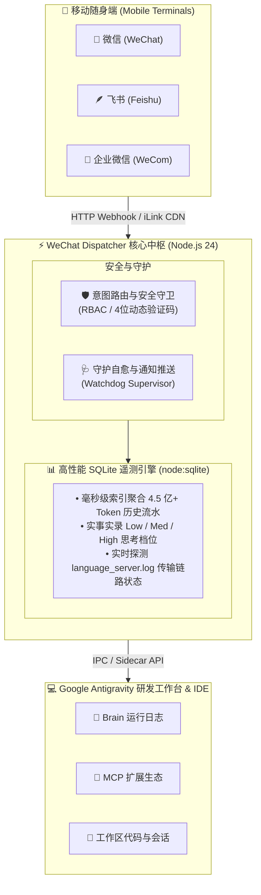

# WeChat Dispatcher & Telemetry Panel

<div align="center">

[](LICENSE)
[](https://nodejs.org/)
[](#)
[](#)
[](https://github.com/zhao-yan-zhao/antigravity-wechat-dispatcher)
[](https://gitee.com/zhao-yan-happyhahaha/antigravity-wechat-dispatcher)

**面向 Google Antigravity / Agentic Coding 的一体化移动端双向研发调度网关与高精度遥测监控看板**

[功能全景](#-核心功能全景) • [系统架构](#-项目架构与核心组件) • [快速开始](#-快速安装与启动) • [指令全集](#-微信--飞书随身指令全集) • [反馈与贡献](#-参与贡献-contributing) • [免责声明](#-免责声明-disclaimer)

</div>

---

## 📖 项目简介

**WeChat Dispatcher** 是专为 **Google Antigravity** 打造的深度研发辅助插件与遥测中枢。它打破了开发者只能端坐在电脑前的束缚，通过微信、飞书、企业微信等移动随身端实现对本地 Agent 任务的**双向驱动、长任务完成自动推送、高危指令安全核验与跨工作区调度**；并在桌面端提供极具极客美感的**毫秒级 SQLite 流量大屏**（支持 Prompt Cache 节约统计、Token 四维拆解、24小时活跃律动与90天热力图）。

### ✨ 核心亮点

* ⚡ **零外部依赖（Zero-Dependency）**：完全基于 Node.js 24 原生标准库（`node:sqlite`、ESM、HTTP/Crypto）与原生 Vanilla JS 构建，安装即用，杜绝繁重的 `npm install` 与原生模块编译烦恼。
* 📱 **全能移动随身端**：支持 20+ 项高频研发指令（查任务进度、看 Diff、创建工程、启停端口、构建打包回传），无论在通勤、会议还是就餐，随时随地掌控编码进度。
* 📊 **企业级遥测中枢**：秒级索引并聚合 4.5 亿+ Token 级全量执行流水，精准追踪入/缓/出/思各阶段 Token 构成与实际成本节省。
* 🛡️ **安全双重锁**：内置 RBAC 管理员白名单与高危指令 60 秒 4 位动态验证码二次确认机制，防止误触或非法遥控。
* 🩺 **自愈与链路探针**：内置 Watchdog 守护进程与底层 Google Cloud RPC 实时传输探针，断线自动重试、崩溃秒级自愈。

---

## 🌟 核心功能全景

### 1. ⚡ 遥测大屏与高精度 SQLite 台账 (Telemetry Ledger)
* **大屏核心指标 (Bento Cards)**：
  * **全量 Token 统计**：毫秒级聚合真实请求的输入（Input）、输出（Output）、缓存（Cache）、思维链（Reasoning）各维度消耗。
  * **Prompt Cache 命中率与降本估算**：实时量化上下文复用率，精确计算为开发者节省的费用（美元与人民币双币种）。
  * **24 小时活跃律动**：直观展示近 24 小时每个整点的请求波峰、波谷与入出倍率。
  * **90 天活动热力图**：类 GitHub 风格沉浸式展示过去一季度的全局活跃密度与连续工作天数。
* **时序周期自由过滤**：支持「分钟 (近1h)」、「小时 (近24h)」、「日 (近7天)」、「周 (近30天)」与「全部历史」无缝切换，数据图表联动平滑过渡。
* **1:1 抓包报文抽屉 (Postman View / Diff View)**：
  * **三栏对比视图**：用户指令（`USER_PROMPT`）、工具调用与执行入参（`TOOL_ACTION`）、本地原始步骤（`TRANSCRIPT`）清晰对照。
  * **单栏聚焦视图**：对齐 Postman 交互体验，Tab 快速切换用户指令、参数 Payload、Raw JSON 与耗时瀑布图。
  * **一键沉淀待办**：任何报错步骤或网络异常均可一键转入迭代任务看板（Kanban）。

### 2. 📱 移动端双向研发网关 (Mobile Dispatch Gateway)
* **微信 / 飞书 / 企微 / PushPlus 全通道互联**：
  * **长任务完成主动通知**：当 Antigravity 完成复杂编译、重构或测试任务后，自动提炼总结摘要并推送至手机端，附带耗时与关键产物。
  * **双向任务投递**：在微信中回复文字、代码或需求，插件自动解析意图并分发至 Antigravity 会话继续执行。
* **多工作区漫游与工程管理**：
  * 支持脱离单一代码仓库，随时切换焦点工作区或创建不挂载目录的「通用独立探索会话」。
* **微信 CDN 文件直推**：支持将本地生成的构建包（`.zip`）、测试报告、`.docx`、`.pdf`、截图等直接通过 CDN 加密协议回传至微信端下载查看。

### 3. 📋 迭代任务看板 (Project Task Kanban)
* **双模式切换**：支持“阶段里程碑视图（Milestones）”与“待办 / 进行中 / 已完成（三列泳道）”无缝切换。
* **工程 TODO 双向同步**：支持从看板一键导出规范的 `TODO.md` 写入当前工作区根目录，与 Git 版本保持同步。

### 4. 🧰 MCP 扩展服务透视 (MCP Tool Inspector)
* 实时透视当前 Antigravity 宿主已激活的所有 MCP（Model Context Protocol）工具生态。
* 查看入参 Schema、服务描述与健康状态，方便排查工具调用失败原因。

---

## 🏗️ 项目架构与核心组件



---

## 🚀 快速安装与启动

### 前置环境要求
* **Node.js**: >= 24.0.0（采用内置 `node:sqlite` 原生数据库）
* **操作系统**: Windows 10/11（首发推荐，深度优化）、Linux、macOS
* **宿主应用**: Google Antigravity / Gemini CLI

### 安装步骤

1. **克隆项目到 Antigravity 插件目录**：
   ```bash
   cd ~/.gemini/config/plugins/
   
   # GitHub 来源 (全球访问)
   git clone https://github.com/zhao-yan-zhao/antigravity-wechat-dispatcher.git

   # 或 Gitee 来源 (国内极速镜像)
   git clone https://gitee.com/zhao-yan-happyhahaha/antigravity-wechat-dispatcher.git
   ```

2. **配置初始化**：
   复制配置模板生成本地私有配置文件：
   ```bash
   cd antigravity-wechat-dispatcher/data
   cp wechat_config.example.json wechat_config.json
   ```

3. **配置参数简要说明**：
   编辑 `wechat_config.json`：
   ```json
   {
     "autoDispatch": true,             // 是否开启自动分发
     "autoStartWechatBot": true,        // 是否随插件守护启动微信随身端
     "enableWebServer": false,          // 独立 Web 网页服务开关 (默认关闭省资源)
     "xmlPort": 18765,                 // 调度网关通信端口
     "notifyChannel": "feishu",         // 通知通道: 'none' | 'wechat' | 'feishu' | 'wecom' | 'pushplus'
     "feishuWebhookUrl": "https://...",// 飞书群自定义机器人 Webhook 地址
     "adminWhitelist": ["admin_id"]    // 管理员白名单，为空则不限制
   }
   ```

4. **在 Antigravity 中启用**：
   重启 Antigravity 或执行刷新，在右侧 Sidecar 插件列表中即可直接点开使用。

---

## 📱 微信 / 飞书随身指令全集

在手机端直接向绑定的机器人发送以下文本指令即可触发对应操作：

### 1. 工程与会话控制
| 指令 | 别名 / 示例 | 功能说明 |
| :--- | :--- | :--- |
| `/workspaces` | `工作区列表`, `查看工程` | 列出本地所有已登记的代码工程及其路径 |
| `/cd <名称>` | `切换工程 <名称>` | 将全局研发焦点切换至指定工作区 |
| `/newproject <名称> [路径]` | `新建工程 demo` | 在本地自动创建并登记新代码工程 |
| `/new -g <需求内容>` | `新建通用会话 <需求>` | 发起脱离特定目录的自由探索会话 |
| `/history [数量]` | `最近会话` | 查看当前工作区最近关联的会话列表 |
| `/clean` | `清理会话` | 切换到空白上下文准备下一次任务 |

### 2. 代码审查与远控运维
| 指令 | 别名 / 示例 | 功能说明 |
| :--- | :--- | :--- |
| `/diff` | `查看改动`, `git diff` | 生成当前工程未提交代码的结构化对比卡片 |
| `/git` | `git status`, `代码状态` | 查看当前代码分支、提交记录与暂存区状态 |
| `/build` | `打包项目`, `一键构建` | 自动执行构建并将产物压缩为 `.zip` CDN 回传至手机 |
| `/service [端口]` | `查看端口`, `重启服务` | 探测本地指定开发端口占用与服务状态 |
| `/ask <源码疑问>` | `问代码 <内容>` | 检索当前工程代码库进行快速解答 |
| `/vision <修改意图>` | （附带图片） | 发送界面设计图或报错截图，指示 Agent 依图改代码 |

### 3. 系统状态与通知配置
| 指令 | 别名 / 示例 | 功能说明 |
| :--- | :--- | :--- |
| `/status` | `系统状态` | 查看 CPU、内存负载、守护进程状态与会话摘要 |
| `/feishu bind <URL>` | `绑定飞书 <URL>` | 一键绑定飞书群 Webhook 机器人通知 |
| `/feishu test` | `飞书测试` | 发送一条高保真富文本测试卡片 |
| `/confirm <验证码>` | `确认 1234` | 针对高危指令（如删除、强制重启）的二次确认 |

---

## 📂 项目结构

```text
antigravity-wechat-dispatcher/
├── assets/                     # 插件图标与界面示意图
├── data/                       # 数据与配置存储目录
│   └── wechat_config.example.json  # 公开示例配置模板
├── sidecars/panel/             # 侧边栏主应用 (Frontend & Backend)
│   ├── index.html              # 现代化磨砂玻璃科技看板主页
│   ├── styles.css              # 响应式布局与主题动效
│   ├── app.js                  # 前端数据流、图表绘制与交互
│   ├── main.mjs                # 后端主服务 (HTTP API, Watchdog, 意图路由)
│   ├── traffic_ledger.mjs      # 原生 SQLite 高性能遥测与链路探针引擎
│   ├── advanced-features.mjs   # 20+ 远程命令解析与执行器
│   └── send_wechat_file.py     # 微信 CDN 协议加密直推辅助脚本
├── scripts/
│   └── sync-all.ps1            # 双向同步脚本
├── .gitignore                  # 严格的隐私与临时数据过滤规则
├── LICENSE                     # MIT 开源许可证
└── README.md                   # 官方说明文档
```

---

## ⚖️ 免责声明 (Disclaimer)

1. **协议合规性**：本项目的第三方微信随身端协议接入（如通过 `chatgpt-on-wechat` 或个人微信 Hook）仅供**技术研究、个人学习与本地开发测试**使用。
2. **风控风险**：使用非官方个人微信接口可能面临微信官方的账号风控或临时功能限制。生产环境强烈推荐使用官方合规的 **企业微信群机器人（WeCom Webhook）** 或 **飞书自定义机器人（Feishu Webhook）**。
3. **安全自负**：本项目提供的远程指令包含执行本地终端命令的能力，虽然内置了 RBAC 白名单与二次验证机制，仍建议用户妥善保管内网端口与 Webhook 密钥，严禁暴露至公网无认证环境。因配置不当导致的系统或数据损失，本项目维护者概不负责。

---

## 🤝 参与贡献 (Contributing)

欢迎任何形式的贡献与反馈！

* 🐛 **报告 Bug 或提交建议**：
  * **GitHub 用户**：欢迎提交 [GitHub Issues](https://github.com/zhao-yan-zhao/antigravity-wechat-dispatcher/issues)
  * **Gitee 用户**：欢迎提交 [Gitee Issues](https://gitee.com/zhao-yan-happyhahaha/antigravity-wechat-dispatcher/issues)
* 💡 **提交代码 (Pull Request)**：
  * 欢迎提交 PR（特别是针对 macOS / Linux 跨平台指令适配或新增通知通道适配）。
  * [GitHub Pull Requests](https://github.com/zhao-yan-zhao/antigravity-wechat-dispatcher/pulls) | [Gitee Pull Requests](https://gitee.com/zhao-yan-happyhahaha/antigravity-wechat-dispatcher/pulls)

---

## 📄 许可证 (License)

本项目采用 [MIT License](LICENSE) 开源许可证。
